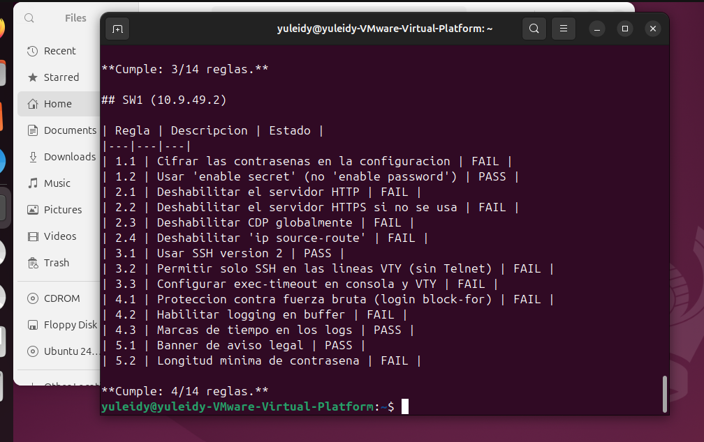
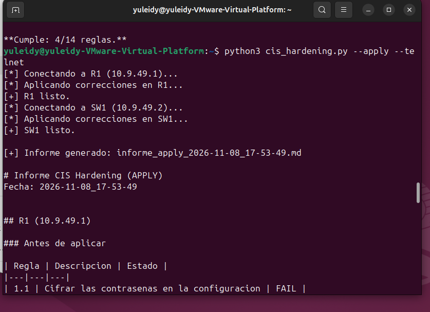
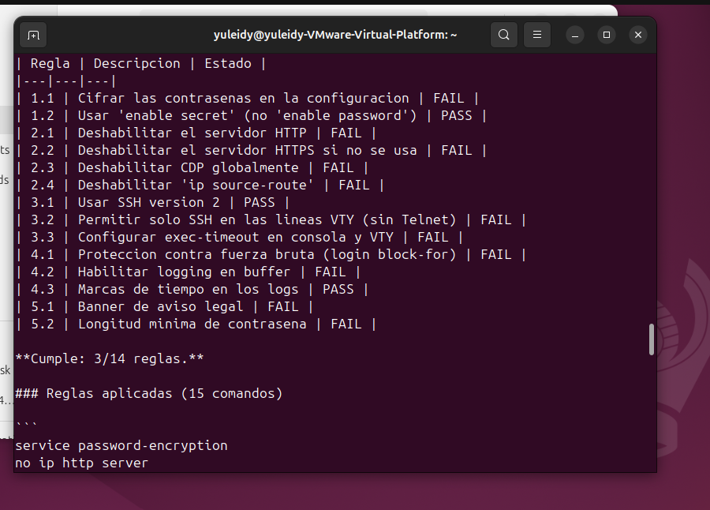
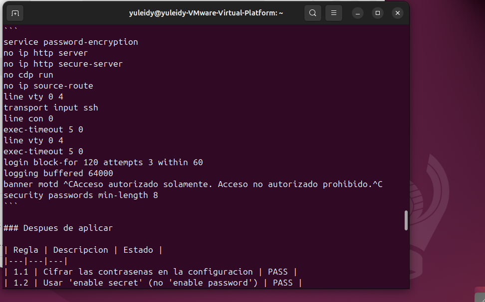
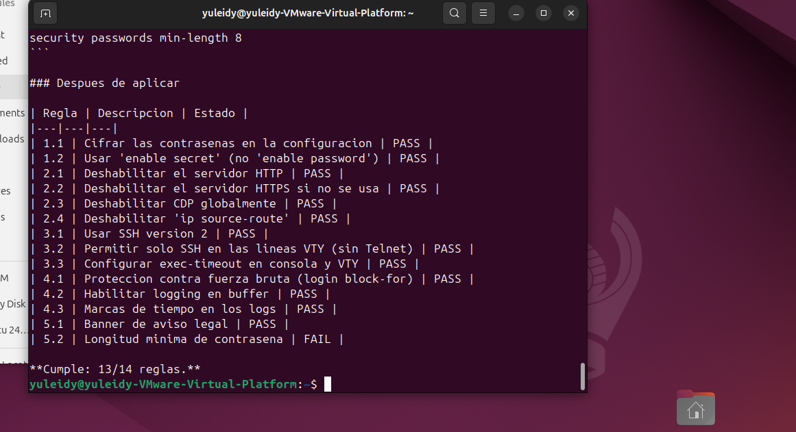
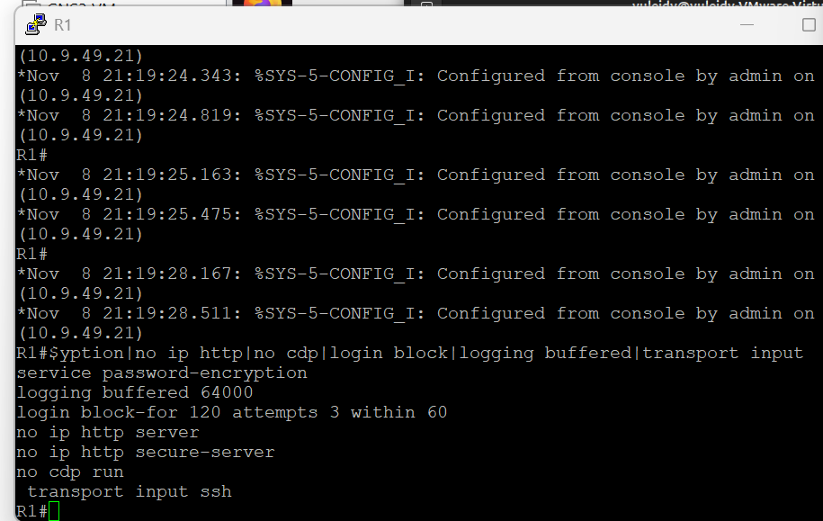
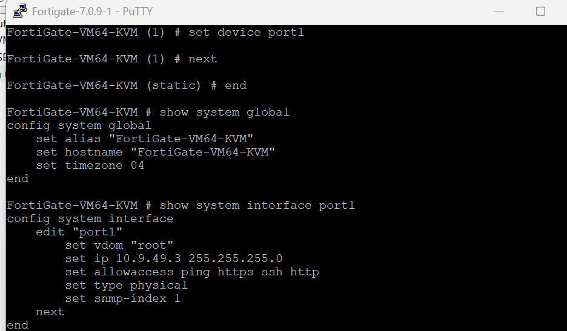
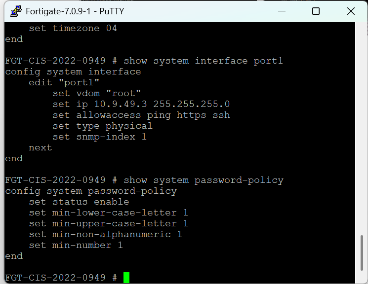

# Hardening de Router, Switch y Firewall con CIS Benchmark

**Autora:** Yuleidy Barrientos · **Matrícula:** 2022-0949
**Asignatura:** Seguridad en Redes — ITLA

## 🎥 Video de la práctica
▶️ **[Ver video en YouTube](https://youtu.be/gwht5LeIbI4)**

## 📄 Documentación completa
📘 **[Ver documento completo (PDF)](documentacion/YULEIDY_BARRIENTOS_HARDENING_CIS_A4.pdf)**

## 📌 Propósito
Aplicar hardening (endurecimiento) a los tres tipos de dispositivo —router, switch y firewall— siguiendo el CIS Benchmark. Desde un servidor Ubuntu se ejecutan scripts en Python que auditan los equipos, generan informes y aplican las correcciones.

## 🗺️ Topología

| Equipo | Rol | IP |
|---|---|---|
| R1 | Router Cisco c7200 | 10.9.49.1 |
| SW1 | Switch Cisco IOSvL2 | 10.9.49.2 |
| FortiGate | Firewall FortiGate 7.0 | 10.9.49.3 |
| SRV-AUDITOR | Ubuntu con los scripts | 10.9.49.21 |

## 🔍 Auditoría inicial (antes del hardening)

## 🔧 Aplicación del hardening

## ✅ Verificación

## 🔥 Firewall (FortiGate)
**Antes del hardening:**

**Después del hardening:**

## 📊 Resultados
| Equipo | Cumplimiento |
|---|---|
| R1 | 3/14 → 13/14 |
| SW1 | 4/14 → 13/14 |
| FortiGate | 6/6 |

## 🛠️ Herramientas
- `cis_hardening.py` → audita y endurece R1 y SW1 (Netmiko)
- `cis_fortigate.py` → audita el FortiGate (Paramiko/SSH)

Uso: `python3 cis_hardening.py --audit` / `--apply`
